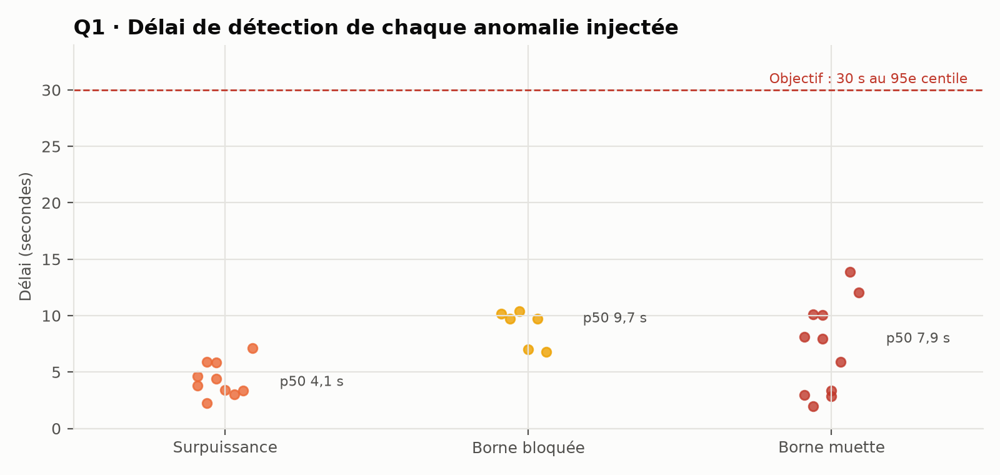
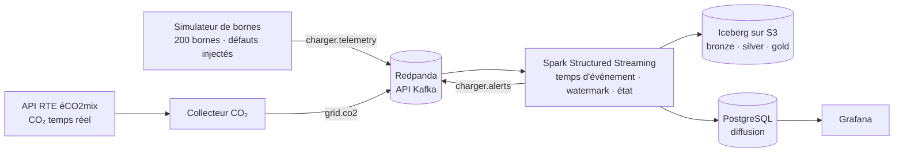

# ⚡ Savoir en quelques secondes qu'une borne va mal : supervision temps réel de bornes de recharge

🇬🇧 [English version](README.md) · 🇫🇷 **Français**

[](https://github.com/MediJr/ev-charging-realtime-streaming/actions/workflows/ci.yml)


> Une **plateforme de streaming** qui surveille 200 bornes de recharge en temps réel : les mesures passent par **Kafka (Redpanda)**,
> sont traitées en **temps d'événement** par **Spark Structured Streaming** (watermark, dédoublonnage, état par borne), stockées dans un
> **lakehouse Apache Iceberg**, enrichies de l'**intensité carbone réelle** du réseau français (RTE), et supervisées dans **Grafana**.
> L'infrastructure Google Cloud cible est écrite en **Terraform**. Tout démarre avec un seul `docker compose up`.

> 🎭 **Scénario fictif, bornes simulées, CO₂ réel.** Le client, *Lumio Recharge*, est l'opérateur fictif du
> [projet 2](https://github.com/MediJr/france-power-mix-incremental-etl), revenu pour une deuxième mission. L'intensité carbone vient en direct
> d'**éCO2mix de RTE**. Ce projet n'est pas affilié à RTE.

## 📄 Rapports

| | |
|---|---|
| 🇫🇷 **Rapport d'ingénierie des données (PDF, 12 pages)** | [Rapport_Supervision_Bornes_Streaming_FR.pdf](docs/livraison/Rapport_Supervision_Bornes_Streaming_FR.pdf) |
| 🇬🇧 **Data engineering report (PDF, 12 pages)** | [Report_EV_Charging_Streaming_EN.pdf](docs/livraison/Report_EV_Charging_Streaming_EN.pdf) |

---

## 💼 Le contexte client

Lumio Recharge apprend qu'une borne est en panne **quand un client appelle**, parfois des heures plus tard. Ses bornes envoient pourtant
leur puissance toutes les 5 secondes. L'exploitation veut une alerte **en moins de 30 secondes**, le CO₂ de chaque recharge en direct, et un
écran de supervision. La DSI prévoit Google Cloud l'an prochain : la solution doit pouvoir y aller sans être réécrite.

| # | Question business |
|---|---|
| **Q1** | En combien de temps une anomalie est-elle détectée ? (objectif : < 30 s au 95e centile) |
| **Q2** | Quelles anomalies, sur quelles bornes, à quelle fréquence ? |
| **Q3** | Combien de CO₂ émet chaque recharge, en direct ? |
| **Q4** | La plateforme tient-elle la charge, et survit-elle à une panne sans perdre ni doubler de données ? |

## 📊 Résultats clés (recette sur plateforme vierge)

| # | Résultat |
|---|---|
| **Q1** | **27 / 27** anomalies injectées détectées, **0 fausse alerte**. Délai : médiane **5,9 s**, p95 **11,6 s**, maximum 13,9 s. |
| **Q2** | Trois types d'anomalie, chacun avec un cycle ouverte → résolue : borne muette (aucun message depuis 60 s), surpuissance (> 110 % de la puissance nominale), borne bloquée (session ouverte à 0 kW depuis 2 min). |
| **Q3** | 186 recharges, 4,8 MWh, 211 kg de CO₂ à l'intensité RTE réelle de la soirée (44 g/kWh) ; valeur en direct par recharge en cours dans Grafana. |
| **Q4** | Spark **tué brutalement** (`SIGKILL`) en plein flux : reprise au micro-lot suivant, 3 654 messages rattrapés en 8,4 s, **0 perdu, 0 doublé**. Rapprochement : **83 292 messages = 82 347 mesures + 808 doublons + 137 retardataires**, chaque exclusion correspondant à la vérité terrain du simulateur. Test de charge à ≈ 2 960 msg/s : le lakehouse suit, le moniteur à état plafonne à **≈ 1 440 msg/s** (≈ 7 000 bornes à une mesure toutes les 5 s ; Lumio en exploite 1 200). |



## 🏗️ Architecture



## 🛠️ Points forts côté data engineering

| Pratique | Mise en œuvre |
|---|---|
| **Temps d'événement** | **Watermark** de 2 min : un retard de moins de 2 min compte encore ; au-delà, la mesure est écartée **et comptée**. |
| **Dédoublonnage** | `dropDuplicatesWithinWatermark(event_id)` : un message renvoyé par une borne ne compte qu'une fois. |
| **État par borne** | `applyInPandasWithState` avec délai de traitement pour détecter l'**absence** de message ; les règles sont en Python pur, testées sans Spark. |
| **Lakehouse « exactly-once »** | Puits Iceberg natif + checkpoints ; ajouts depuis `foreachBatch` marqués du numéro de micro-lot ; diffusion par UPSERT. |
| **Rapprochement prouvé** | Chaque message Kafka est expliqué (gardé, doublon ou trop tardif) et confronté à la vérité terrain du simulateur. |
| **Maintenance du lakehouse** | Rétention de 90 jours, compaction des petits fichiers, expiration des instantanés (`spark/maintenance.py`). |
| **Observabilité** | Chaque micro-lot (débit, durée, lignes écartées par la watermark) est enregistré et affiché dans la supervision. |
| **Infrastructure en code** | Cible GCP en Terraform : bucket du lakehouse (région Paris, règles de cycle de vie), BigQuery + BigLake, comptes de service au moindre privilège, alerte de budget. |
| **Défauts trouvés en testant pour de vrai** | Colonne de dates vide refusée par Arrow ; `event_id` **répétés après un redémarrage** (graine fixe) ; borne muette **manquée pendant un rattrapage** → filet de sécurité en temps d'événement. Chacun a son test de non-régression. |

## 🚀 Démarrage rapide

**Prérequis :** Docker Desktop (environ 5 Go de mémoire pour Docker), Git.

```bash
git clone https://github.com/MediJr/ev-charging-realtime-streaming.git
cd ev-charging-realtime-streaming
copy .env.example .env                   # puis choisir les trois mots de passe
docker compose up -d --build
```

Ouvrir Grafana sur http://127.0.0.1:3001 : bornes, alertes et CO₂ apparaissent en moins d'une minute.

## 📚 Documentation de la mission

| Étape | Document |
|---|---|
| 1. Demande | [Brief client](docs/mission/2026-10-26-01-brief-client.md) |
| 2. Cadrage | [Compte rendu](docs/mission/2026-10-26-02-compte-rendu-cadrage.md) |
| 3. Engagement | [Cahier des charges](docs/mission/2026-10-26-03-cahier-des-charges.md) |
| 4. Réalisation | [Journal de bord](docs/journal/2026-10-26.md) · [ADR](docs/decisions/) · [Dictionnaire de données](docs/dictionnaire-de-donnees.md) |
| 5. Recette | [Rapports (PDF)](docs/livraison/) · [PV de recette](docs/livraison/2026-10-27-pv-recette.md) · [Rapport d'endurance de 14 h](docs/livraison/2026-10-28-rapport-endurance.md) |

> ⚠️ **Découvert pendant l'endurance de 14 h** : après une coupure de toute la plateforme (veille de l'ordinateur), le filet de sécurité du
> silence déclare toutes les bornes muettes en même temps (1 458 fausses alertes en 9 rafales). L'intégrité des données a tenu
> (1,6 million de messages, 0 perdu, 0 doublé) ; la détection d'un incident global est spécifiée pour la version 1.1.

---

## 👤 Auteur

**Lumu Bamana Manasse**, data engineer en reconversion depuis la data analyse · GitHub : [@MediJr](https://github.com/MediJr)

**Niveau 4** d'un parcours de 7 projets. Niveaux précédents :
[0 · ETL Steam](https://github.com/MediJr/ubisoft-vs-ea-steam-etl) ·
[1 · Entrepôt OMS ODD 3](https://github.com/MediJr/who-sdg3-health-etl) ·
[2 · Pipeline incrémental du mix électrique](https://github.com/MediJr/france-power-mix-incremental-etl) ·
[3 · Modern data stack e-commerce](https://github.com/MediJr/olist-ecommerce-modern-data-stack).

## 📄 Licence et données

Code sous licence [MIT](LICENSE). Intensité carbone : **RTE, éCO2mix**, via Open Data Réseaux Énergies, sous Licence Ouverte (Etalab).
Les données des bornes sont simulées.
