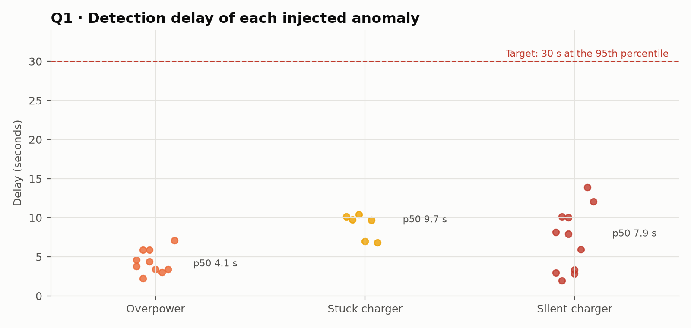
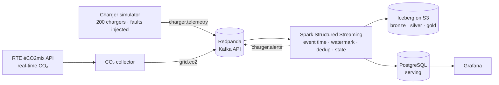

# ⚡ Know within seconds that a charger is failing: real-time EV charging supervision

🇬🇧 **English** · 🇫🇷 [Version française](README.fr.md)

[](https://github.com/MediJr/ev-charging-realtime-streaming/actions/workflows/ci.yml)


> A **streaming platform** that watches 200 EV chargers in real time: telemetry flows through **Kafka (Redpanda)**, is processed in
> **event time** by **Spark Structured Streaming** (watermark, deduplication, per-charger state), stored in an **Apache Iceberg
> lakehouse**, enriched with the **real carbon intensity** of the French grid (RTE), and supervised in **Grafana**. The target Google Cloud
> infrastructure is written in **Terraform**. Everything starts with one `docker compose up`.

> 🎭 **Fictional scenario, simulated chargers, real carbon data.** The client, *Lumio Recharge*, is the fictional EV charging operator of
> [project 2](https://github.com/MediJr/france-power-mix-incremental-etl), back for a second engagement. Carbon intensity comes live from
> **RTE éCO2mix**. Not affiliated with RTE.

## 📄 Reports

| | |
|---|---|
| 🇬🇧 **Data engineering report (PDF, English, 12 pages)** | [Report_EV_Charging_Streaming_EN.pdf](docs/livraison/Report_EV_Charging_Streaming_EN.pdf) |
| 🇫🇷 **Rapport d'ingénierie des données (PDF, français, 12 pages)** | [Rapport_Supervision_Bornes_Streaming_FR.pdf](docs/livraison/Rapport_Supervision_Bornes_Streaming_FR.pdf) |

---

## 💼 Business context

Lumio Recharge learns that a charger is down **when a customer calls**, sometimes hours later. Its chargers already send their power
every 5 seconds. The operations team wants an alert **within 30 seconds**, live CO₂ for each charging session, and a supervision screen.
The IT department plans to move to Google Cloud next year: the solution must get there without a rewrite.

| # | Business question |
|---|---|
| **Q1** | How fast is an anomaly detected? (target: < 30 s at the 95th percentile) |
| **Q2** | Which anomalies, on which chargers, how often? |
| **Q3** | How much CO₂ does each charging session emit, live? |
| **Q4** | Does the platform handle the load, and survive a crash without losing or duplicating data? |

## 📊 Key results (acceptance run on a fresh platform)

| # | Result |
|---|---|
| **Q1** | **27 / 27** injected anomalies detected, **0 false alerts**. Detection delay: median **5.9 s**, p95 **11.6 s**, max 13.9 s. |
| **Q2** | Three anomaly types, each with an open → resolved life cycle: silent charger (no message for 60 s), overpower (> 110 % of rating), stuck charger (open session at 0 kW for 2 min). |
| **Q3** | 186 sessions, 4.8 MWh, 211 kg CO₂ at the real RTE intensity of that evening (44 g/kWh); live value per ongoing session in Grafana. |
| **Q4** | Spark **hard-killed** (`SIGKILL`) mid-stream: resumed at the next micro-batch, caught up 3,654 messages in 8.4 s, **0 lost, 0 duplicated**. Reconciliation: **83,292 messages = 82,347 measures + 808 duplicates + 137 too-late**, every exclusion matching the simulator's ground truth. Load test at ~2,960 msg/s: the lakehouse keeps up, the stateful monitor is the bottleneck at **~1,440 msg/s** (≈ 7,000 chargers at one message every 5 s; Lumio runs 1,200). |



## 🏗️ Architecture



| Service | Role | URL |
|---|---|---|
| `redpanda`, `console` | Event log (Kafka API) and topic browser | http://127.0.0.1:8080 |
| `spark` | Six streaming queries in one application | http://127.0.0.1:4040 |
| `lake` | S3-compatible storage of the lakehouse (SeaweedFS) | `127.0.0.1:8333` |
| `postgres` | Iceberg JDBC catalog + serving database | `127.0.0.1:5435` |
| `grafana` | Supervision screen (13 panels, provisioned as code) | http://127.0.0.1:3001 |
| `simulator`, `co2-collector` | Producers | |

## 🛠️ Data engineering highlights

| Practice | Implementation |
|---|---|
| **Event time, not processing time** | 2-minute **watermark**: late messages within 2 min still count; later ones are dropped **and counted**. |
| **Deduplication** | `dropDuplicatesWithinWatermark(event_id)`: a message re-sent by a charger counts once. |
| **Per-charger state** | `applyInPandasWithState` with a processing-time timeout detects the **absence** of messages; the rules themselves are pure Python, unit-tested without Spark. |
| **Exactly-once lakehouse** | Native Iceberg sink + checkpoints; `foreachBatch` appends tagged with the micro-batch id in the snapshot, so a replayed batch is skipped. Serving writes are UPSERTs. |
| **Proven reconciliation** | Every Kafka message is explained: kept, duplicate or too late, and matched against the simulator's ground truth. |
| **Lakehouse maintenance** | 90-day raw retention, small-file compaction, snapshot expiry (`spark/maintenance.py`). |
| **Observability** | A `StreamingQueryListener` logs every micro-batch (throughput, duration, rows dropped by watermark) into the supervision screen. |
| **Infrastructure as code** | GCP target in Terraform: lakehouse bucket (Paris region, lifecycle rules), BigQuery + BigLake, least-privilege service accounts, budget alert. `fmt` and `validate` in CI. |
| **Bugs found by testing for real** | Arrow refusing an all-empty timestamp column; seeded `event_id`s **repeating after a restart**; a silent charger **missed during catch-up** (processing-time timeout) → event-time safety net. Each one has its regression test. |

## 🚀 Quick start

**Requirements:** Docker Desktop (about 5 GB of memory for Docker), Git.

```bash
git clone https://github.com/MediJr/ev-charging-realtime-streaming.git
cd ev-charging-realtime-streaming
copy .env.example .env                   # Windows (cp on macOS/Linux), then set the three passwords
docker compose up -d --build
```

Open Grafana at http://127.0.0.1:3001: chargers, alerts and CO₂ appear within a minute.

```bash
docker run --rm lumio-spark:1.0.0 python3 -m pytest -q tests                                      # 22 tests, including Spark end to end
docker compose run --rm --no-deps spark /opt/spark/bin/spark-submit --master local[2] spark/recette.py   # acceptance checks
docker compose exec spark /opt/spark/bin/spark-submit --master local[2] spark/maintenance.py            # lakehouse maintenance
```

Terraform (no GCP account needed to validate):

```bash
terraform -chdir=terraform init -backend=false
terraform -chdir=terraform validate
```

## 📁 Repository structure

```text
├── src/lumio_stream/   simulator, CO₂ collector, anomaly rules (pure Python), report charts
├── spark/              streaming_job.py (6 queries), maintenance.py, recette.py
├── sql/                serving database (tables, business views)
├── grafana/            datasource and dashboard, provisioned as code
├── terraform/          Google Cloud target infrastructure
├── docker/             app and Spark images
├── tests/              anomaly rules, simulator, Spark end to end (no Kafka needed)
└── docs/               engagement (French), 5 ADRs, work log, data dictionary, reports, acceptance
```

## ⚠️ Limitations

- Chargers are **simulated**; real ones would speak OCPP through a gateway.
- Single-node Spark: the stateful monitor tops out at ~1,440 msg/s on this laptop; beyond, a cluster (Dataproc) and more partitions.
- Processing-time timeouts misbehave during catch-up: silences are then reported **late** (by the event-time safety net), not missed.
- The GCP infrastructure is validated, not deployed (no `plan` without credentials).
- **Found in the 14-hour [endurance report](docs/livraison/2026-10-28-rapport-endurance.md):** after a platform-wide interruption
  (host sleep), the silence safety net flags every charger at once (1,458 false alerts in 9 bursts). Data integrity held (1.6 M messages,
  0 lost, 0 duplicated); fleet-wide incident detection is specified for v1.1.

## 📚 Engagement documents

| Step | Document |
|---|---|
| 1. Request | [Client brief](docs/mission/2026-10-26-01-brief-client.md) |
| 2. Scoping | [Meeting minutes](docs/mission/2026-10-26-02-compte-rendu-cadrage.md) |
| 3. Commitment | [Statement of work](docs/mission/2026-10-26-03-cahier-des-charges.md) |
| 4. Delivery | [Work log](docs/journal/2026-10-26.md) · [ADRs](docs/decisions/) · [Data dictionary](docs/dictionnaire-de-donnees.md) |
| 5. Acceptance | [Reports (PDF)](docs/livraison/) · [Acceptance sign-off](docs/livraison/2026-10-27-pv-recette.md) · [14-hour endurance report](docs/livraison/2026-10-28-rapport-endurance.md) |

*Engagement documents are written in French, as for a French client.*

---

## 👤 Author

**Lumu Bamana Manasse**, data engineer transitioning from data analytics · GitHub: [@MediJr](https://github.com/MediJr)

**Level 4** of a seven-project data engineering portfolio. Previous levels:
[0 · Steam ETL](https://github.com/MediJr/ubisoft-vs-ea-steam-etl) ·
[1 · WHO SDG 3 warehouse](https://github.com/MediJr/who-sdg3-health-etl) ·
[2 · Incremental power-mix pipeline](https://github.com/MediJr/france-power-mix-incremental-etl) ·
[3 · E-commerce modern data stack](https://github.com/MediJr/olist-ecommerce-modern-data-stack).

## 📄 License and data

Code released under the [MIT License](LICENSE). Carbon intensity: **RTE, éCO2mix**, via Open Data Réseaux Énergies, under the French
Open Licence (Etalab). Charger data is simulated.
