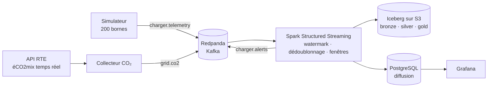

# 03 · Cahier des charges (Statement of Work)

> 🎭 **Scénario fictif** : voir le [brief client](2026-10-26-01-brief-client.md).

| | |
|---|---|
| **Référence** | LUM-2026-002 |
| **Version** | 1.0 |
| **Date** | 2026-10-26 |
| **Client** | Lumio Recharge, représenté par Sophie Bernard |
| **Prestataire** | Data engineer indépendant |
| **Statut** | ✅ Validé par le client (voir section 10) |

---

## 1. Objectifs

1. Recevoir en continu les mesures de 200 bornes simulées et l'intensité carbone **réelle** de RTE.
2. **Détecter trois anomalies en moins de 30 s** (95e centile) : borne muette, surpuissance, borne bloquée.
3. Calculer **en direct** l'énergie et le CO₂ de chaque recharge.
4. Conserver l'historique dans un **lakehouse Iceberg** (bronze, silver, gold).
5. Superviser le parc sur un **écran Grafana**.
6. Décrire l'infrastructure GCP cible en **Terraform**.

## 2. Architecture

| Brique | Choix | Raison |
|---|---|---|
| Journal d'événements | **Redpanda** (API Kafka) | Compatible Kafka, un seul binaire, léger sur un poste |
| Traitement | **Spark 4.0 Structured Streaming** | Temps d'événement, watermark, état tolérant aux pannes, référence du marché |
| Lakehouse | **Apache Iceberg 1.10** sur S3 (SeaweedFS), catalogue JDBC dans PostgreSQL | Format ouvert, transactions ACID, lisible par BigQuery |
| Diffusion | **PostgreSQL 17** | Grafana l'interroge nativement |
| Supervision | **Grafana** | Standard de l'observabilité, tableaux provisionnés en code |
| Cloud | **Terraform** (Google Cloud Storage, BigQuery, comptes de service) | Infrastructure versionnée, revue, reproductible |

## 3. Données

| Topic | Producteur | Contenu | Clé |
|---|---|---|---|
| `charger.telemetry` | Simulateur | `event_id`, `charger_id`, `site_id`, `event_time` (UTC), `power_kw`, `energy_kwh`, `status`, `session_id`, `rated_kw` | `charger_id` |
| `grid.co2` | Collecteur RTE | Créneau, intensité carbone (g/kWh), consommation | `slot` |
| `charger.alerts` | Spark | Type d'alerte, borne, heure de l'anomalie, heure de détection | `charger_id` |

## 4. Règles d'anomalie

| Anomalie | Règle | Gravité |
|---|---|---|
| Borne muette | Aucun message depuis plus de **60 s** | Critique |
| Surpuissance | `power_kw` > `rated_kw` × **1,10** | Haute |
| Borne bloquée | Session ouverte et `power_kw` = 0 pendant plus de **2 min** | Moyenne |

## 5. Exigences de fiabilité

- **Temps d'événement**, watermark de **2 min** : un message en retard de moins de 2 min compte ; au-delà, il est écarté **et compté**.
- **Dédoublonnage** sur `event_id` : un message renvoyé ne compte qu'une fois.
- **Points de reprise** Spark et écritures **idempotentes** : un arrêt brutal ne perd ni ne double aucune mesure.

## 6. Livrables

| # | Livrable |
|---|---|
| L1 | Simulateur et collecteur CO₂ (Python) |
| L2 | Traitement Spark Structured Streaming |
| L3 | Tables Iceberg bronze, silver, gold |
| L4 | Tableau Grafana provisionné |
| L5 | Code Terraform GCP, validé |
| L6 | Tests automatisés et intégration continue |
| L7 | Rapports en français et en anglais (PDF) |
| L8 | README, dictionnaire de données, ADR, journal, PV de recette |

## 7. Hors périmètre

- Le déploiement réel sur Google Cloud (pas de budget cette année)
- Les vraies bornes et leur protocole (OCPP) : les messages sont simulés
- L'envoi des alertes par SMS ou messagerie (piste d'évolution)

## 8. Risques

| Risque | Mesure |
|---|---|
| Messages en retard, en double, dans le désordre | Temps d'événement, watermark, dédoublonnage, compteurs |
| Panne du moteur de traitement | Checkpoints, reprise testée en recette |
| Mémoire limitée d'un poste (Spark, Kafka) | Mémoire bornée par service, Spark en mode local |
| API RTE indisponible | Dernière intensité connue conservée, fraîcheur affichée |

## 9. Critères d'acceptation

| # | Critère |
|---|---|
| C1 | La plateforme démarre avec `docker compose up` sur un poste neuf |
| C2 | Les trois anomalies injectées sont toutes détectées |
| C3 | Délai de détection < 30 s au 95e centile |
| C4 | Les doublons injectés ne sont comptés qu'une fois ; les messages trop tardifs sont comptés à part |
| C5 | Un arrêt brutal de Spark, puis sa reprise, ne perd ni ne double aucune mesure |
| C6 | Le CO₂ de chaque recharge utilise l'intensité RTE réelle |
| C7 | `terraform validate` passe ; les tests et l'intégration continue sont verts |
| C8 | Aucun secret versionné |

## 10. Validation

| | Client | Prestataire |
|---|---|---|
| **Nom** | Sophie Bernard | Data engineer |
| **Date** | 2026-10-26 | 2026-10-26 |
| **Mention** | Bon pour accord | Bon pour exécution |
